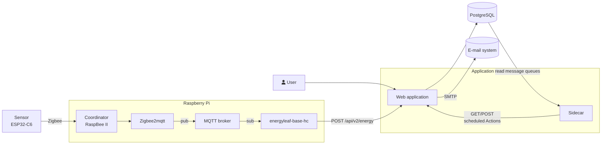

<div align="center">
<strong>Energyleaf</strong>  
<br/>

</div>


Energyleaf is a research project of the [Karlsruhe Institute of Technology (KIT)](https://wi2.win.kit.edu/), WIN-WI 2 department for Environmental and Sustainable Information Systems.

The Project is based around visualizing the participants household's electricity consumption. A custom-built sensor reads a typical German digital electricity meter (moderne Messeinrichtung, mMe) non-invasively through its optical interface (IEC 62056-21), upgrading it into a "smart meter". The platform is used to research around the question, how digital energy applications can help foster and teach energy literacy in households.

The platform has three components:

- **Sensor**: sits on the electricity meter, reads the transmission from the electricity meter every 30 seconds and transmits it to the base station.
- **Base station**: a Raspberry Pi that receives the sensor's messages over Zigbee and forwards them to the application via a REST API.
- **Web application**: stores the measurements, provides the user interface and runs background actions like creating energy reports and calculating peaks in energy usage.



## Status

This repository is a release of all artifacts used in our latest field experiment. It is not being actively developed through this repository. Issues and pull requests will not be addressed. You are welcome to fork the project and develop it independently. All artifacts are provided as is. 

## Compatibility

- Works only with German digital electricity meters (moderne Messeinrichtung, mMe) that expose the IEC 62056-21 optical interface.
- Most meters require a PIN to enable the detailed data output. You must request it from your grid operator (Messstellenbetreiber).
- The web application's UI is in German.

See [Limitations](https://github.com/energyleaf/energyleaf/wiki/Limitations) before you start.

## Repository layout

| Path             | Contents                                           |
| ---------------- | -------------------------------------------------- |
| [`app/energyleaf`](https://github.com/energyleaf/energyleaf/blob/main/app/energyleaf) | Web application sources                            |
| [`app/sidecar`](https://github.com/energyleaf/energyleaf/blob/main/app/sidecar)    | Sidecar service running scheduled actions          |
| [`firmware`](https://github.com/energyleaf/energyleaf/blob/main/firmware)       | Sensor firmware sources                            |
| [`raspberrypi`](https://github.com/energyleaf/energyleaf/blob/main/raspberrypi)    | Base station configuration (Zigbee2MQTT converter) |
| [`3d_models`](https://github.com/energyleaf/energyleaf/blob/main/3d_models)      | Sensor housing models                              |

## Getting started

The [wiki](https://github.com/energyleaf/energyleaf/wiki/Home) contains guides to build, deploy and use all components.

- **Run the complete stack on one Raspberry Pi:** [Getting Started Guide](https://github.com/energyleaf/energyleaf/wiki/Getting_Started_Guide#path-a)
- **Build and flash the sensor:** [Building the Sensor](https://github.com/energyleaf/energyleaf/wiki/Building_the_sensor#building-the-sensor)
- **Deploy the application on your own server:** [Manual Setup Guide](https://github.com/energyleaf/energyleaf/wiki/Getting_Started_Guide#path-b)

## Local development (web application)

Requirements:
- [bun](https://bun.com/docs/installation)
- PostgreSQL 17. All features of the application depend on the database. We recommend Podman Desktop to run a PostgreSQL service bundled with pgAdmin for quick database edits.

Setup:

```bash
cd app/energyleaf
bun install
```

Create a local env file, for example `.env.development.local`, with at least `DATABASE_URL`. See \$ Deploying the Application (link) for all variables. Then create the tables and an admin user:

```bash
bun db:migrate
bun run src/scripts/bootstrap.ts --email=<email> --password=<password>
```

Start the application:

```bash
bun run dev
```

The application is now available at <http://localhost:3000>. You can use the admin user to login and create new users for the participants view.

### Simulating a sensor

Create a sensor in the admin panel ([see Adding a new sensor to the Instance](https://github.com/energyleaf/energyleaf/wiki/Deploying_the_Application#adding-a-new-sensor-to-the-instance)) and copy its token. Then send a measurement:

```bash
curl -X POST \
  -H "Content-Type: application/json" \
  -H "Authorization: Bearer <SENSOR_TOKEN>" \
  -d '{
    "value": 123.4567,
    "value_out": 0.0,
    "value_current": 0,
    "date": 1672531200000,
    "sensor_type": 0
  }' \
  "http://localhost:3000/api/v2/energy"
```

- `value` and `value_out` are accumulated sums in kWh. The application rejects a request if `value` is smaller than the previous value (the one with the latest `date`). Also both must be positive.
- `date` is a Unix timestamp in milliseconds.
- `sensor_type` is `0` for the v2 electricity sensor (the only one supported in this version).
- `value_current` is the current power in W and can be negative.

See the [API Reference](https://github.com/energyleaf/energyleaf/wiki/API) for details.

## Sensor development

See [Building the Sensor](https://github.com/energyleaf/energyleaf/wiki/Building_the_sensor#building-the-sensor).
